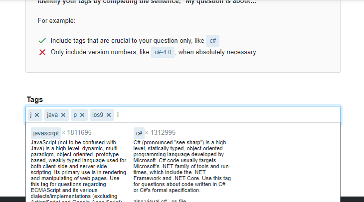
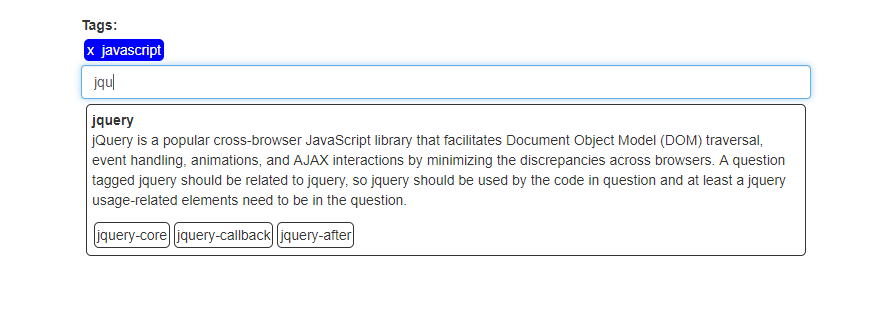

# Dynamic Tag Field

A Stack Overflow–style tag picker written in plain JavaScript (ES6), HTML and CSS. No framework, no build step.

[](https://github.com/didagu/dynamic-tag-field-processing/actions/workflows/ci.yml)

**Live demo:** https://didagu.github.io/dynamic-tag-field-processing/ (redeployed on every merge to `master`)

Start typing and matching tags appear under the input, each with its description and alternative names, with the matched text underlined. Click a result (or use the arrow keys and Enter) to add it as a tag. Click the `x` on a tag to remove it. Escape clears the search.

| Stack Overflow (reference) | This project |
| --- | --- |
|  |  |

## Run it

There's nothing to install. Clone the repo and open `index.html` in a browser, or serve the folder:

```bash
git clone https://github.com/didagu/dynamic-tag-field-processing.git
cd dynamic-tag-field-processing
python3 -m http.server 8000
```

Then go to http://localhost:8000.

## Tests

End-to-end tests use [Playwright](https://playwright.dev) and need Node.js 22 and Python 3 (for the local server):

```bash
npm install
npx playwright install chromium
npm test
```

CI runs the same suite on every pull request. Merges to `master` deploy to GitHub Pages once the tests pass.

## How it works

| File | What it does |
| --- | --- |
| `taglist.js` | The tag data: six hard-coded sample tags, each with an id, title, description and alternative names |
| `app.js` | Renders every tag as a hidden result card, filters the cards on each keystroke and handles keyboard input |
| `Utils.js` | Builds the result cards, highlights matches, moves the active result, and adds or removes selected tags |
| `style.css` | Layout for the tags and result cards (on top of Bootstrap 3 CSS) |
| `tests/` | Playwright tests for search, selection, removal and keyboard use |

A tag matches when the search text appears anywhere in its title or in one of its alternative names, ignoring case. Tags you've already picked are left out of the results.

## Known limitations

- Tag data is static; there's no API behind it.
- Descriptions aren't searched, only titles and alternative names.

## Feedback

Bug reports and suggestions are welcome as [GitHub issues](https://github.com/didagu/dynamic-tag-field-processing/issues).
